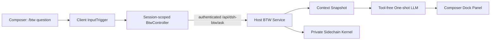

# dsh-btw

[DeepSeek Harness](https://github.com/deepseek-ai/deepseek-harness)를 위해 구현된 `/btw` 사이드 질문(Side Question) 플러그인.

> 개인적으로 Claude Code의 `/btw` 명령어를 유용하게 사용하여, DeepSeek Harness(DSH)용으로 동일한 인터랙션을 구현한 플러그인입니다.

`/btw`는 메인 Agent의 작업을 방해하지 않고 현재 컨텍스트와 관련된 질문을 빠르게 물어볼 때 사용합니다. 질문은 독립적인 일회성 모델 요청을 통해 답변되며, 결과는 입력창 상단의 임시 패널에 표시됩니다. 메인 대화 메시지로 추가되지 않으며, DSH의 일반 세션 목록에도 기록되지 않습니다.

본 프로젝트는 비공식 커뮤니티 플러그인이며, Anthropic, Claude Code 또는 DeepSeek AI와 관련이 없습니다.

## `/btw`는 무엇을 하는 기능인가요?

`/btw`는 메인 대화 옆에서 "잠깐 덧붙여 질문하기(by the way)"로 이해할 수 있습니다. Agent가 비교적 긴 작업을 수행 중일 때, 세부 사항을 확인하고 싶어지는 경우가 자주 있습니다. 방금 언급한 설정 파일 이름이 무엇이었는지, 이미 검토한 특정 코드 섹션을 왜 그렇게 작성했는지, 이전에 어떤 방안을 채택하기로 결정했는지 등을 확인할 때입니다. 일반 메시지를 직접 전송하면 메인 대화의 진행 방향이 바뀌고 이후 컨텍스트가 증가하며, 별도의 세션을 새로 열면 현재 작업에서 이미 축적된 정보를 잃게 됩니다.

BTW는 바로 이 딜레마를 해결합니다. 요청 제출 시점까지 상위 세션에서 안전하게 재사용할 수 있는 컨텍스트를 읽어와 독립적인 일회성 답변을 생성한 뒤, 닫을 수 있는 임시 패널에 결과를 표시합니다. 메인 Agent는 원래 작업을 중단 없이 계속 진행하며, 질문과 답변 또한 일반 대화 기록에 남지 않습니다.

핵심 가치:

- **메인 작업 방해 없음**: 메인 Agent가 생각 중이거나 도구를 호출하는 동안에도 질문할 수 있으며, BTW는 사이드에서 독립적으로 실행됩니다.
- **메인 컨텍스트 오염 방지**: 임시 질문이 메인 작업의 방향을 바꾸지 않으며, 이후 대화 기록을 차지하지도 않습니다.
- **배경 설명 재입력 불필요**: 상위 세션에서 이미 논의된 코드, 결론 및 의사결정 맥락을 그대로 인지하고 있습니다.
- **빠른 세부 사항 확인**: 현재 컨텍스트 내에 이미 답이 있는 짧은 질문을 확인하기에 적합합니다.

전형적인 사용 예:

```text
/btw 방금 말한 설정 파일 이름이 뭐였지?
/btw 여기서 직접 실행하지 않고 큐를 사용한 이유가 뭐야?
/btw 우리가 최종 결정한 캐시 전략이 뭐였더라?
/btw 이 에러가 방금 수정한 코드랑 관련이 있나?
```

### 언제 `/btw`를 쓰지 말아야 하나요?

| 요구 사항 | 권장 선택 |
| --- | --- |
| 현재 세션이 이미 알고 있는 내용에 대해 단 한 번의 빠른 답변만 필요한 경우 | `/btw` |
| 아직 확인하지 않은 파일을 읽거나 명령어를 실행해야 하거나 웹 검색이 필요한 경우 | 일반 메시지 또는 subagent |
| 후속 질문을 계속 이어가거나 함께 논의하거나 구현 방안을 변경해야 하는 경우 | 일반 메시지 |
| 실제로 파일을 수정하거나 작업을 수행해야 하는 경우 | 일반 메시지 또는 도구를 갖춘 subagent |

BTW는 도구 사용 권한이 없으며 후속 턴(대화 턴)도 지원하지 않습니다. 무료 로컬 조회가 아니라 모델에 대한 추가적인 1회성 API 요청입니다. 본 플러그인은 상위 요청의 공유 prompt/cache 접두사를 최대한 재사용하여 중복 컨텍스트 비용을 낮추도록 설계되었습니다.

이러한 인터랙션 포지셔닝은 [Claude Code 공식 `/btw` 문서](https://code.claude.com/docs/en/interactive-mode#side-questions-with-btw)를 참고하였으며, DSH 버전의 저수준 구현, 비공개 사이드체인 및 캐시 호환 계층은 모두 본 프로젝트에서 독자적으로 구현되었습니다.

## 주요 기능

| 기능 | 동작 방식 |
| --- | --- |
| 메인 작업 병렬 실행 | 메인 Agent가 작업 중일 때도 `/btw` 질문을 제출할 수 있으며, 메인 작업이 중단되지 않습니다. |
| 컨텍스트 공유 | 상위 세션의 현재 모델 설정, 시스템 프롬프트, 도구 스키마, 안전한 메시지 접두사를 재사용합니다. |
| 일회성 답변 | 1회의 모델 생성만 수행하며 도구를 실행하지 않고 후속 질문을 이어가지 않습니다. |
| 세션 격리 | 메인 SessionStore에 사용자 메시지, 답변 또는 숨김 세션을 기록하지 않습니다. |
| 임시 인터페이스 | Composer(입력창) 상단에 Markdown 답변이 도킹되어 표시되며 입력창을 가리지 않습니다. |
| 프라이버시 아카이브 | 비공개 JSONL(`private-jsonl`), 메모리 전용(`memory`), 완전 미저장(`none`) 3가지 사이드체인 모드를 지원합니다. |
| 캐시 보호 | Anthropic/pi-ai 라우트는 캐시 경계를 공유 접두사로 이동하며, 기타 라우트는 provider 관리에 맡깁니다. |
| 취소 가능 | 패널을 닫으면 요청이 중단되며 독립적인 타임아웃 제어를 지원합니다. |

## 사용 방법 및 동작

메인 대화에서 최소 한 개 이상의 메시지를 보낸 후, 입력창에 다음과 같이 입력합니다:

```text
/btw 이 오류의 가장 유력한 원인은 무엇인가요?
```

DSH는 입력창을 즉시 해제하므로 메인 Agent는 계속 작업을 이어갈 수 있습니다. BTW 응답 생성이 완료되면 입력창 바로 위에 결과 패널이 표시됩니다.

- `↑` / `↓`: 긴 답변 스크롤
- `Enter` / `Space` / `Esc`: 답변 패널 닫기
- 요청 처리 중 사용자 취소는 명시적인 `Cancel` 버튼으로만 가능합니다. 바깥 클릭·패널의 `Enter` / `Space` / `Esc`는 생성 중 요청을 닫거나 취소하지 않습니다. 포커스된 Cancel 버튼의 키보드 활성화는 지원하며, 생성 완료 후에는 기존 닫기 동작이 유지됩니다.
- 질문 없이 `/btw` 입력: 현재 세션의 가장 최근 성공 문답과 캐시 표시를 추가 모델 호출 없이 다시 열기. 실패·취소는 기존 성공 문답을 덮어쓰지 않으며, 성공 기록이 없으면 안내만 표시합니다.
- 세션을 이동해도 요청과 문답은 유지되며, 복귀하면 진행 상태 또는 완료된 답변이 표시됩니다. BTW를 사용한 최근 **10개 세션의 컨트롤러만** 페이지 메모리에 유지합니다. 질문·빈 `/btw` 제출·기존 BTW 세션 재방문이 사용 순서를 갱신하고, 일반 세션 방문·렌더링·답변 도착은 갱신하지 않습니다.
- 11번째 컨트롤러가 필요하면 가장 오래 사용하지 않은 세션의 요청을 취소하고 문답을 지웁니다. 생성 중인 요청도 예외가 아닙니다. 세션 보관(Archive)이 성공하거나 Host에서 세션이 제거될 때도 정리하며, 보관 해제로 문답이 복원되지는 않습니다. 새로고침·앱 종료·플러그인 종료 시에도 사라지고 영속 저장은 하지 않습니다.

패널을 닫은 후에는 BTW 내용이 메인 대화 기록, 세션 사이드바 또는 일반 Session 로그에 표시되지 않습니다.

## 아키텍처 및 구현



### 1. Client 입력 가로채기 (Client InputTrigger)

Client는 DSH의 input-trigger 파이프라인을 통해 `/btw`를 감지하고 가로챕니다. 제출 후 일반 메시지 전송 파이프라인을 거치지 않으므로 질문이 메인 세션 이벤트 스트림에 유입되지 않습니다. 상위 Session마다 독립적인 `BtwController`가 할당되어 요청 상태, 취소 및 UI 라이프사이클을 관리합니다.

### 2. 신뢰할 수 있는 Host RPC (Trusted Host RPC)

브라우저는 인증된 Host RPC를 통해 `sessionId`, `requestId`, 질문을 Host로 전송합니다. Host는 구조가 올바르고 활성(live) Agent가 존재하는 세션 요청만 수락하며, 브라우저의 취소 시그널과 플러그인 타임아웃을 병합 처리합니다.

### 3. 컨텍스트 스냅샷 (Context Snapshot)

Host는 상위 Agent로부터 다음 항목들을 스냅샷으로 추출합니다:

- 현재 provider, model, reasoning, sampling 등의 요청 구성 설정
- 현재 system prompt
- 현재 tool schemas
- 도구 호출 균형이 유지되는 가장 긴 메시지 접두사 (tool call-result balanced message prefix)
- 현재 처리 중인 사용자 메시지 (상위 Session에 이미 진입한 경우)

도구 호출 균형 알고리즘은 "tool call만 있고 tool result는 없는" 불완전한 상태의 기록을 남기지 않습니다.

### 4. 일회성 모델 호출 (One-shot LLM Call)

BTW는 독립적인 `sidechainId`를 발급하여 생성을 요청합니다. 상위 요청과 동일한 prompt/cache 접두사를 최대한 유지하기 위해 도구 스키마(tool schemas)는 보존되지만, 플러그인은 도구 실행기를 등록하지 않으며 2차 턴 모델 호출을 수행하지 않습니다. 모델이 도구 호출만을 반환하는 경우 UI에 읽기 쉬운 폴백 안내를 표시합니다.

### 5. 숨겨진 사이드체인 (Hidden Sidechain)

BTW는 일반 DSH Session을 생성하지 않습니다. 선택적 감사 기록은 플러그인 자체 sidechain kernel에서 관리합니다:

- `private-jsonl`: 기본 모드, `$DSH_HOME/btw-sidechains/v1`에 저장
- `memory`: 현재 프로세스 메모리에만 유지
- `none`: 전혀 저장하지 않음

`private-jsonl` 디렉터리 권한은 `0700`, 파일 권한은 `0600`으로 설정되며, 보존 일수와 최대 개수에 따라 자동 정리됩니다. 기록에는 질문, 컨텍스트 스냅샷, 답변이 포함되므로 다중 사용자 공유 머신 환경에서는 보안 및 프라이버시 요구사항에 맞게 적절한 모드를 선택하십시오.

### 6. `skipCacheWrite` 동등 처리

대상 DSH 버전에는 공개된 `skipCacheWrite` 플랫폼 옵션이 없습니다. 본 플러그인은 pi-ai의 Anthropic Messages 라우트에 대해 요청별 독립 adapter를 사용하며, `onPayload`를 통해 일회성 BTW 말미의 `cache_control` 마커를 마지막 공유 접두사 블록으로 이동시켜 재사용되지 않을 꼬리 부분에 대한 캐시 작성을 방지합니다. 브리지 계층은 `0.2.1-rc.2`의 내부 구조를 기준으로 고정되어 auth 및 첨부 파일 파싱 훅을 유지하며, 이미 등록된 공식 adapter를 변경하지 않습니다. 직결 경로는 0.2.1의 요청 프로젝션을 동시에 복제하여 상위 요청의 prompt/cache 접두사와의 분기를 방지합니다.

네이티브 DeepSeek 자동 서버 사이드 캐싱에는 이에 대응하는 wire-level 비활성화 파라미터가 없으므로 provider-managed 상태를 유지하며 클라이언트 기능을 임의로 위조하지 않습니다.

## 설치 방법

### 환경 요구 사항

- Node.js `^22.19.0 || >=24.0.0` (이번 실측 환경은 `24.16.0`, DSH 0.2.1 데스크톱 런타임은 `24.21.0`)
- pnpm / Corepack
- DeepSeek Harness `0.2.1-rc.2`
- 정상 작동하는 `desktop` 프로필 (데스크톱 GUI) 또는 `web` 프로필

> `0.4.0` 버전은 DSH `0.2.1-rc.2`를 대상으로 합니다. `0.1.5-rc.1` / `0.1.5-rc.2`는 더 이상 지원 범위에 포함되지 않습니다. 먼저 DSH를 업그레이드하고 기존 프로필을 백업하십시오. 호환 범위는 명시된 정확한 버전을 기준으로 하며, 이후 버전의 자동 호환을 보장하지 않습니다. 전체 근거 및 미검증 항목은 [호환성 기록](./docs/compatibility-0.4.0.md)을 참조하십시오.

### 방법 1: GitHub에서 직접 설치

```bash
dsh plugin --profile desktop add github:iyllyt/dsh-btw --ignore-scripts
```

순수 Web 프로필을 사용하는 경우 `desktop`을 `web`으로 변경하십시오. `web` 프로필은 `dsh --profile web --dump-config` 명령으로 `id: btw`를 확인할 수 있습니다. `desktop` 프로필은 Electron 애플리케이션이 독점하므로 CLI의 `--dump-config` 실행이 거부됩니다. 대신 프로필의 `package.json` 및 `node_modules/dsh-btw/package.json`을 확인하십시오. 먼저 대상 프로필을 백업하고, 버전이 확인된 DSH를 사용하십시오. 전역 명령어가 없는 경우 `npx @deepseek-ai/dsh@0.2.1-rc.2`를 사용할 수 있습니다. 설치 후 DSH 데스크톱 앱을 완전히 종료했다가 다시 시작한 다음 GUI를 새로고침하십시오. 새로 추가된 번들은 패치 핫 리로드(HMR)에만 의존할 수 없습니다.

저장소에는 빌드된 `lib/`가 커밋되어 있으므로 GitHub에서 설치할 때 `prepare` 빌드 스크립트 실행 권한이 필요하지 않습니다. 프로덕션 환경에서는 커밋 해시 고정을 권장합니다:

```bash
dsh plugin --profile desktop add github:iyllyt/dsh-btw#<commit-sha> --ignore-scripts
```

### 방법 2: 로컬 패키징 설치 (실측 검증 방식)

`add ./dsh-btw`를 직접 실행하거나 개발 디렉터리를 심볼릭 링크하지 마십시오. Node가 링크를 따라 저장소 내 개발 의존성을 로드할 수 있으며, 호스트는 자체 DSH 의존성 트리를 사용합니다. 패키징 설치(tarball)는 이러한 위험을 방지하지만, 실제 설치된 의존성 버전을 여전히 확인해야 합니다.

저장소에 사전 빌드된 `lib/`가 이미 포함되어 있으므로 단순 설치 시에는 다시 빌드할 필요가 없습니다. 저장소 루트 디렉터리에서 다음 PowerShell 명령을 실행합니다 (`dsh`는 기존 호스트 명령 사용):

```powershell
$dshProfileHome = if ($env:DSH_HOME) { $env:DSH_HOME } else { Join-Path $env:USERPROFILE '.dsh' }
$artifactDir = Join-Path $dshProfileHome 'plugin-artifacts'
New-Item -ItemType Directory -Force -Path $artifactDir | Out-Null
npm.cmd pack --ignore-scripts --pack-destination "$artifactDir"
dsh plugin --profile desktop add "$artifactDir/dsh-btw-0.4.0.tgz" --ignore-scripts
# DSH 데스크톱 앱을 완전히 종료 후 다시 시작해야 적용됩니다.
```

소스 코드를 수정한 경우 먼저 개발 검증을 실행한 후 위의 패키징 단계를 진행하십시오:

```bash
pnpm install --frozen-lockfile --ignore-scripts
pnpm run typecheck
pnpm run build
pnpm test
```

`web` 프로필의 `--dump-config`에 `id: btw`가 나타나야 하며, `desktop` 프로필은 `package.json`의 bundles 항목과 설치된 `dsh-btw` 버전을 기준으로 확인합니다. 재설치에 대비해 설치 시 참조한 tarball을 보관하십시오. 이후 업데이트 시에는 새 버전 번호와 새 파일 이름을 사용합니다. Windows 실행 정책, 피어 의존성 경고 및 인증 문제 해결은 [설치 안내](./docs/install-windows.md)를 참조하십시오.

### 제거

```bash
dsh plugin --profile desktop remove dsh-btw
```

플러그인을 제거해도 `$DSH_HOME/btw-sidechains/v1`에 이미 작성된 비공개 감사 기록은 자동으로 삭제되지 않습니다.

## 설정

번들에는 다음과 같은 기본 설정이 내장되어 있습니다:

```yaml
- insert:
    - id: btw
      name: dsh-btw
      config:
        timeoutMs: 120000
        sidechain:
          mode: private-jsonl
          retentionDays: 7
          maxSessions: 500
```

기본값을 재정의하려면 `$DSH_HOME/profiles/desktop/cordis.patch.yml` (또는 `web` 프로필의 해당 파일)에 동일한 `id: btw`를 가진 완전한 플러그인 항목을 추가하십시오. 예를 들어 BTW 아카이브 저장을 완전히 비활성화하려면:

```yaml
- insert:
    - id: btw
      name: dsh-btw
      config:
        timeoutMs: 120000
        sidechain:
          mode: none
          retentionDays: 7
          maxSessions: 500
```

설정 가능한 옵션:

| 필드 | 기본값 | 설명 |
| --- | --- | --- |
| `timeoutMs` | `120000` | Host 측 단일 BTW 타임아웃 (밀리초 단위) |
| `sidechain.mode` | `private-jsonl` | `private-jsonl`, `memory` 또는 `none` |
| `sidechain.root` | `$DSH_HOME/btw-sidechains/v1` | 비공개 JSONL 파일의 사용자 정의 절대 경로 |
| `sidechain.retentionDays` | `7` | 파일 보존 일수 |
| `sidechain.maxSessions` | `500` | 최대 보존 사이드체인 세션 수 |

DSH의 패치(patch)는 동일 플러그인 라인의 `config` 전체를 교체하며 재귀적으로 병합하지 않습니다. 따라서 재정의할 때는 유지하려는 모든 설정 필드를 명시해야 합니다.

## 소스 코드 구조

```text
src/
├── client/
│   ├── input-source.ts       # /btw 명령어 식별 및 입력 파이프라인 가로채기
│   ├── controller.ts         # 세션별 비동기 상태 및 취소 관리
│   ├── overlay.tsx           # Dock 패널, Markdown 렌더링 및 키보드 상호작용
│   └── index.tsx             # Client 플러그인 등록
├── host/
│   ├── service.ts            # 요청 유효성 검사, 타임아웃 및 오케스트레이션
│   ├── rpc-route.ts          # 공식 인증 체계 하의 플러그인 자체 API 경로
│   ├── context-snapshot.ts   # 상위 세션 요청 헤더 및 균형 잡힌 컨텍스트 스냅샷
│   ├── one-shot.ts           # 도구 없는 일회성 모델 생성
│   ├── cache-boundary.ts     # Anthropic 캐시 경계 마이그레이션
│   ├── btw-pi-ai-adapter.ts  # 0.2.1 요청 수준 캐시 adapter
│   └── sidechain-kernel.ts   # 비공개 JSONL / memory / none 저장소
└── shared/
    └── protocol.ts           # Client/Host RPC 프로토콜 및 런타임 유효성 검사
```

Host와 Client는 동일한 DSH 번들의 두 가지 실행 면(surface)입니다. `cordis.patch.yml`은 Host 플러그인을 로드하고, `package.json`의 `dsh.client` 메타데이터는 브라우저 측 플러그인을 로드합니다.

## 개발

```bash
pnpm install
pnpm test
pnpm run typecheck
pnpm run build
```

현재 테스트는 컨텍스트 균형 유지, 시스템 프롬프트 기록 업데이트, 캐시 경계, 입력 가로채기, 공식 prepared-call 런타임, 인증 엔벌로프(envelope), 프론트엔드 빌드 모듈 로딩, 사이드체인 격리 및 Controller 수명 주기를 포함합니다. 프론트엔드 산출물 테스트는 `lib/client.js`를 읽으므로 소스 코드 수정 후에는 빌드를 먼저 수행한 뒤 테스트해야 합니다.

## 호환성

- 현재 버전: `0.4.0`
- 대상 DSH: `0.2.1-rc.2` (Web 및 Desktop GUI 공통 클라이언트 런타임)
- Node.js: `^22.19.0 || >=24.0.0`
- 검증 완료: 타입 체크, 22개 자동화 테스트, 빌드, 격리된 프로필에서의 설치·시작·인증 RPC·제거 검증.
- 0.4.0 적응 변경점: 호스트 요청에 `session.toolHistory()` 포함, pi-ai 직결 경로에서 0.2.1의 `projectToolUpdates`/파일/이미지 프로젝션 복제, 클라이언트 `MarkdownLabels.code.toolbarLabels` 보완, `CommandClaim`에 `name` 추가, 0.2.1의 `role: 'tool'` 메시지 규격에 맞춘 도구 결과 균형 처리.
- 자동 검사 미포함 항목: 실제 모델 생성, 브라우저 전체 인터랙션, 실제 서비스 캐시 동작, Node.js 22, Linux/macOS, 롤백. `compatible` 표기가 모든 환경과 시나리오에서의 검수를 의미하지는 않습니다.
- pi-ai 캐시 브리지는 예상되는 adapter 내부 구조가 변경될 경우 안전하게 fail closed 처리됩니다. 기타 provider는 DSH 공용 `LlmRuntime.prepareCall()` 경로를 따릅니다.
- 로컬 `pnpm-workspace.yaml`은 공식 DSH 의존성 트리를 고정하며, Windows junction 환경에서 모든 전이적 의존성을 올바르게 해석할 수 있도록 `nodeLinker: hoisted`를 사용합니다. 이 설정은 이미 설치된 프로필에는 영향을 주지 않습니다.

전체 검증 과정 및 재현 명령어는 [호환성 기록](./docs/compatibility-0.4.0.md)을 참조하십시오.

## 라이선스

[MIT](./LICENSE)
